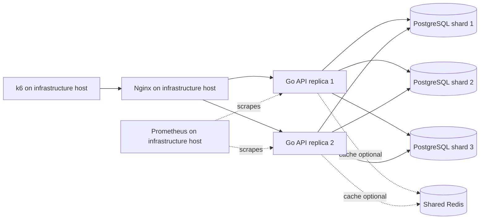
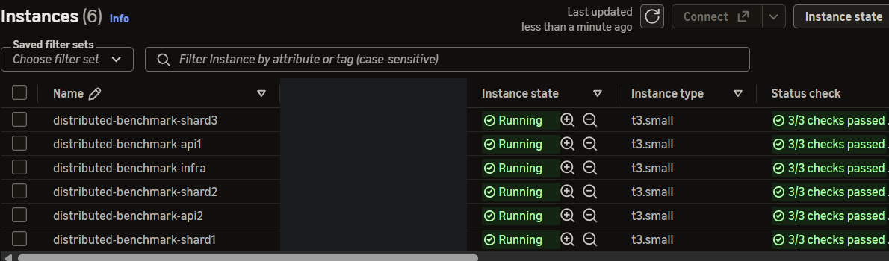
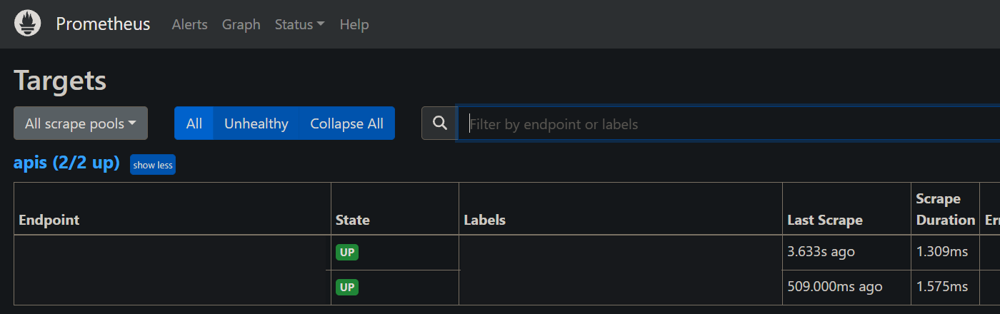
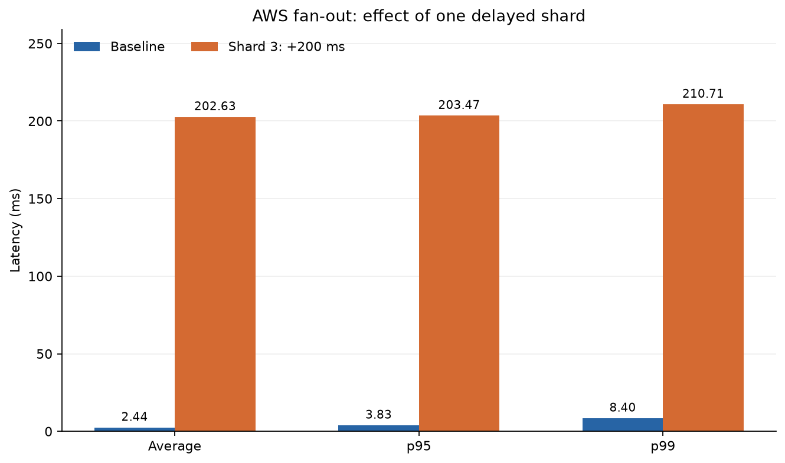
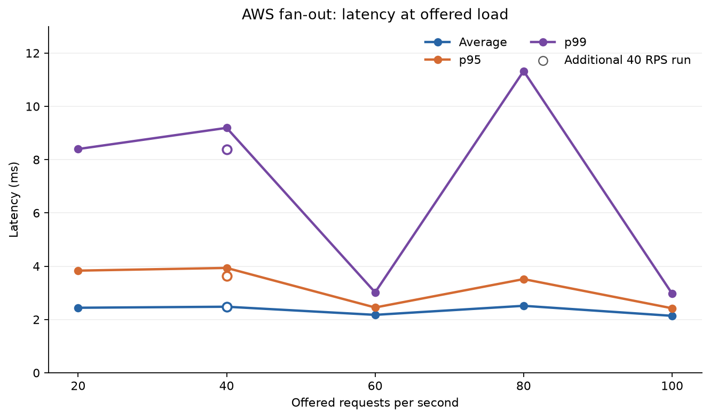
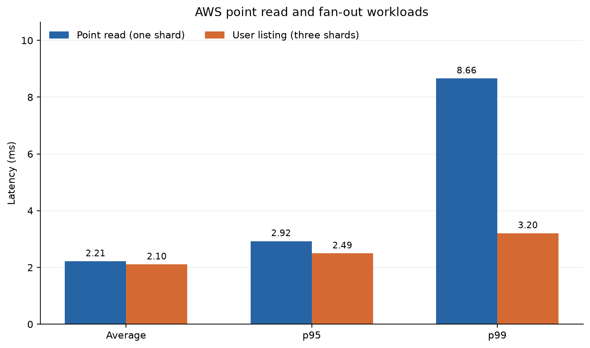

# AWS Systems Performance

A Go URL shortener used to study how database placement, caching, and fan-out affect distributed application behavior. It runs locally with Docker Compose and was also deployed as a temporary six-instance AWS lab for controlled performance experiments.

In the AWS smoke test, adding **200 ms of artificial delay to reads from one shard** raised average user-list latency from **2.44 ms to 202.63 ms**, while achieved throughput stayed near **20 requests/s**. This illustrates why a request that needs every shard can be dominated by its slowest dependency.

## Architecture



The AWS lab used **six `t3.small` EC2 instances in `us-east-2`**, all in one availability zone: one host for Nginx, k6, Prometheus and Redis; two dedicated API hosts; and one host per PostgreSQL shard. Redis was running, but application caching was disabled for these measurements. The infrastructure was destroyed after the experiments.

Each short code is mapped to a shard using consistent hashing. The two API replicas use the same placement configuration, so either replica routes a code to the same owner. These are **application replicas**; the PostgreSQL shards hold different partitions and are not database replicas. A point read contacts one shard. A user listing or popularity query fans out to all three, merges the results, and fails if a required shard is unavailable rather than returning an incomplete answer.

**Stack:** Go, PostgreSQL, Redis, Nginx, Prometheus, k6, Docker Compose, Terraform and EC2. The local project also includes DynamoDB Local experiments.

<details>
<summary>Deployment and monitoring screenshots</summary>

The historical EC2 view shows the six lab hosts while running. The Prometheus view shows both API targets up. Instance identifiers and endpoint addresses have been redacted; the infrastructure has since been destroyed.





</details>

## AWS benchmark results

The tests used 1,000 deterministic synthetic links, cache disabled, and k6's constant-arrival-rate executor. Each run lasted approximately **30 seconds**. The user-list workload queries all three shards; the point-read workload retrieves a link from one shard. The slow-shard condition injected a 200 ms delay in the API's reads from shard 3 on both replicas, rather than changing PostgreSQL itself.

| Experiment | Achieved requests/s | Average | p95 | p99 | HTTP failure rate |
| --- | ---: | ---: | ---: | ---: | ---: |
| User-list baseline, 20 offered requests/s | 20.0 | 2.44 ms | 3.83 ms | 8.40 ms | 0% |
| User list, shard 3 delayed 200 ms | 19.9 | 202.63 ms | 203.47 ms | 210.71 ms | 0% |
| User list, 40 offered requests/s | 40.0 | 2.48 ms | 3.94 ms | 9.19 ms | 0% |
| User list, 60 offered requests/s | 60.0 | 2.17 ms | 2.45 ms | 3.02 ms | 0% |
| User list, 80 offered requests/s | 80.0 | 2.51 ms | 3.52 ms | 11.32 ms | 0% |
| User list, 100 offered requests/s | 100.0 | 2.14 ms | 2.42 ms | 2.97 ms | 0% |
| Point read, 50 offered requests/s | 50.0 | 2.21 ms | 2.92 ms | 8.66 ms | 0% |
| User list, 50 offered requests/s | 50.0 | 2.10 ms | 2.49 ms | 3.20 ms | 0% |

### One slow shard



At 20 offered requests/s, both runs completed 601 requests with no HTTP failures. The injected delay illustrates the cost of waiting for a required slow shard. It is a controlled demonstration, not a measurement of an actual PostgreSQL failure.

### Load ramp



The highest tested rate achieved approximately 100 requests/s with no observed HTTP failures. It does **not** establish maximum throughput. Open markers show a second 40 requests/s run; its broader collection window overlapped the other 40 requests/s run, so concurrent activity cannot be ruled out.

### Point read and fan-out



These are different requests with different database work and response sizes. Their observed latency difference does not isolate the cost of fan-out.

**Interpretation:** Most conditions have one short run, so p95 and especially p99 can vary substantially. The load generator shared its host with other infrastructure services; all instances shared an availability zone; and T3 CPU-credit behavior may affect sustained results. The cache was disabled, so these results say nothing about cache performance. The tests did not determine a throughput ceiling.

The [curated k6 summaries and methodology](results/aws-2026-11/README.md) include all nine runs, including both 40 requests/s observations, source mappings, limitations, and chart regeneration instructions. The original local benchmark folders are excluded from Git because they contain host and infrastructure details.

## Engineering lessons

- **Fan-out amplifies slow dependencies:** Complete cross-shard results wait for every required shard. Partial failures can leave healthy-shard point reads available while global queries fail.
- **Placement is part of the data contract:** Both API replicas must agree on shard IDs and hashing settings. Changing placement requires a migration; it does not move existing rows automatically.
- **Measurement conditions matter:** Offered and achieved rate, generator saturation, CPU credits, failure rate, and repetitions all matter when interpreting latency. A short successful run is not a capacity guarantee.
- **Caching changes the experiment:** Redis is a best-effort optimization with possible stale reads. Separate local cache experiments exist, but caching was off in the AWS results above.

## Run locally

Requirements: Docker and Docker Compose. Go 1.24+ is needed to run Go tooling directly.

```sh
docker compose up -d --build
# Retry until the API is ready:
curl http://localhost:8000/health
docker compose exec api seed
```

Open [Link Lab](http://localhost:8000). Prometheus is at [localhost:9090](http://localhost:9090). The default Compose setup uses a single PostgreSQL database; see the [local reference](docs/local-reference.md) for three-shard Compose, API examples, metrics, caching and test commands. To stop the stack while retaining its data, run `docker compose down`.

- [Local experiment guides](experiments/): indexing, caching, sharding and fan-out.
- [AWS deployment and teardown runbook](deploy/aws/README.md): review its plan, security limits and cost estimate before any new deployment.
- [Benchmark evidence and reproduction](results/aws-2026-11/README.md).
- [Screenshot instructions](docs/images/README.md).
